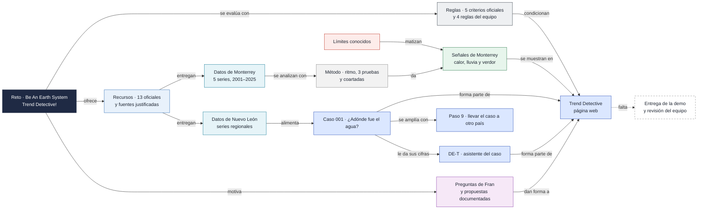
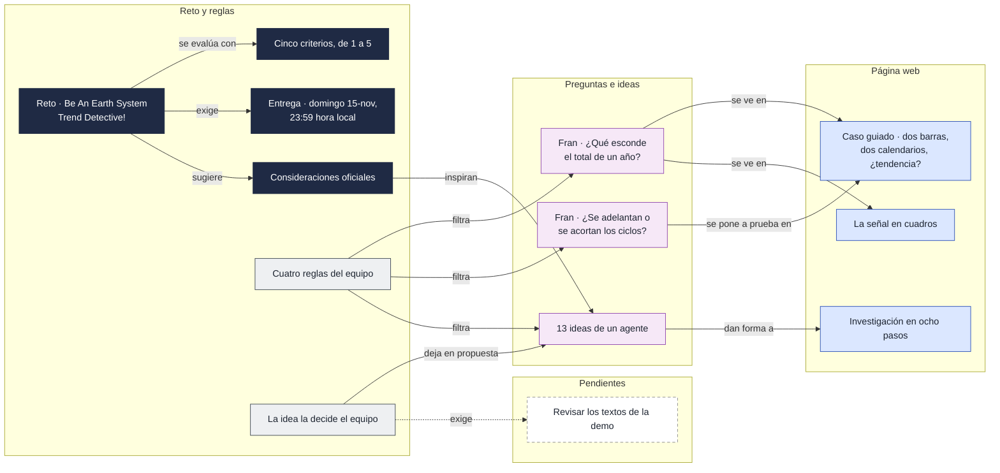
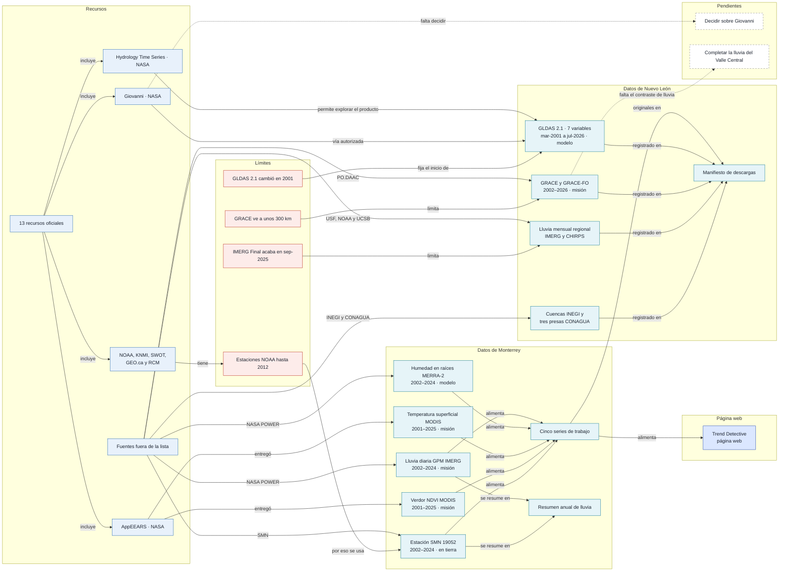
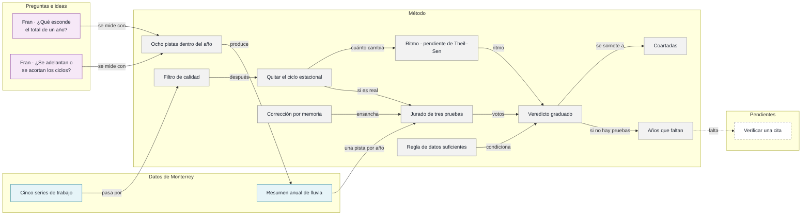
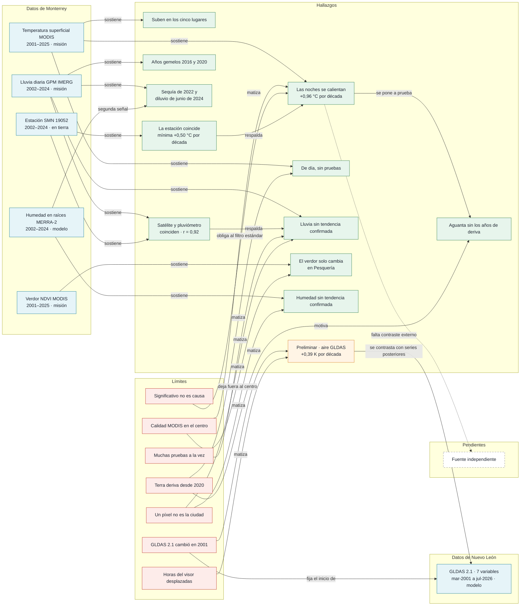
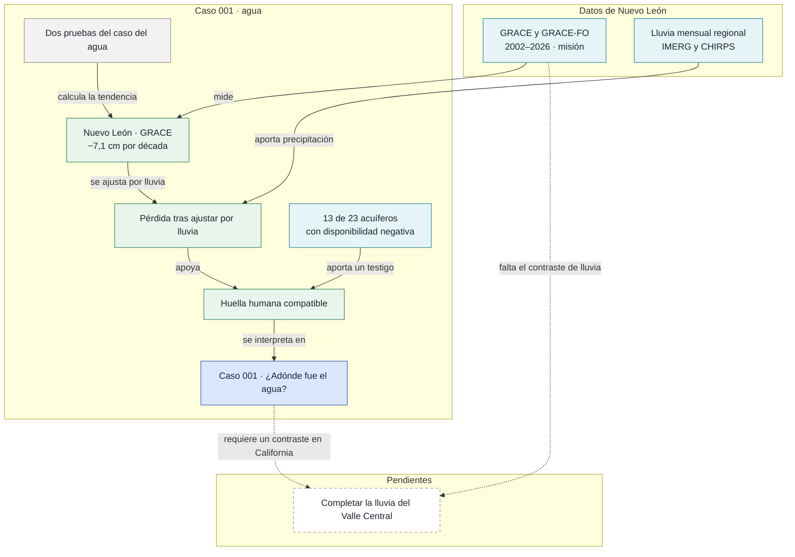
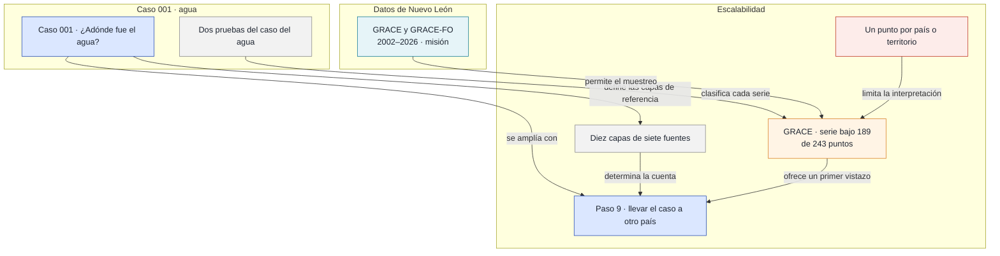
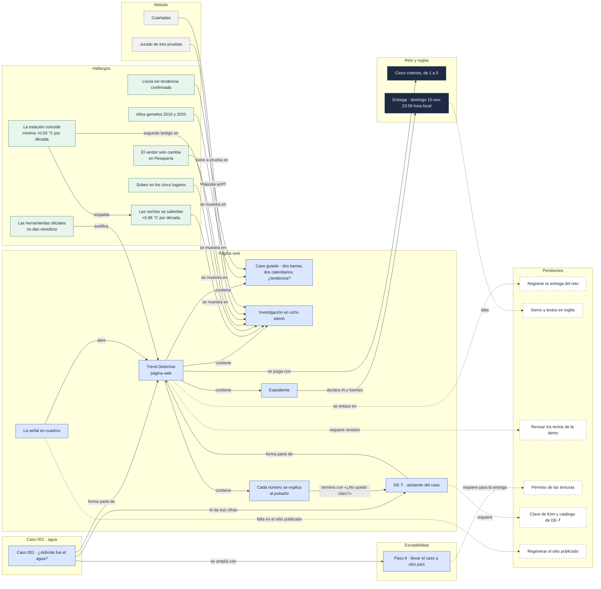
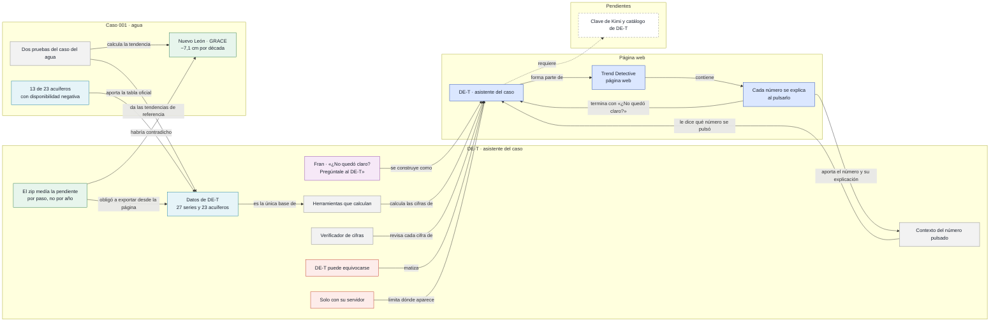

# Grafo de conocimiento de RAACK

[Índice](../INDICE.md) · [Reto](RETO.md) · [Reglas oficiales](REGLAS_OFICIALES.md) · [Mapa de datos](MAPA_DE_DATOS.md) · [Grafo de contexto](CONTEXTO.md) · [Datos del grafo en JSON](CONOCIMIENTO.json)

El equipo investiga qué explica la pérdida de agua en Nuevo León y qué ocultan los promedios anuales en Monterrey. Este grafo conecta las preguntas con los datos, el método, los hallazgos y las pruebas que aún faltan. Cada vista abre una parte del grafo. El [contexto](CONTEXTO.md) conserva la historia del trabajo.

Actualizado el 15 de noviembre de 2026. Contiene 104 nodos y 160 relaciones. Las etiquetas «fijado por prueba» y «calculado por la página» remiten al motor del caso correspondiente.

## Lo esencial en un minuto

- El equipo eligió investigar el ciclo del agua en Nuevo León. El Valle Central de California permite comparar el almacenamiento con menos datos locales. [Verificación de las cifras](DIAGNOSTICO_AGUA.md).
- El paso 9, propuesto por Fran, cuenta las capas que ya se tienen o se podrían obtener en otro país. [Escalabilidad](ESCALABILIDAD.md).
- En el Caso 002, las noches del centro de Monterrey se calientan a razón de 0,96 °C por década entre 2001 y 2025. En 2016 y 2020, dos totales de lluvia casi iguales se distribuyeron de formas muy distintas. [Pruebas del laboratorio](../app/src/lib/analysis.test.ts) · [Tabla anual de lluvia](../datos/derivados/lluvia_anual.csv).
- DE-T, el asistente que entregó Fran, responde con las mismas cifras que la página: salen de water.json y un verificador las busca en los datos antes de mostrarlas. Se abre bajo la explicación de cada número. Al integrarlo se vio que el zip medía la pendiente por paso (GRACE −8,53 frente a −7,135 cm por década). [Qué se hizo y por qué](de-t/DE-T.md).

## Mapa general

Cada caja resume un grupo; las secciones siguientes lo abren.

Una flecha continua conecta hechos documentados. Una flecha punteada lleva a algo que queda pendiente.

## 1 · Reto, reglas e ideas

Qué pide el reto, con qué se evalúa y qué preguntas guían la herramienta.

| Qué | Qué dice | Origen | Fuente |
|---|---|---|---|
| Reto · Be An Earth System Trend Detective! | Crear una herramienta que elija variables medidas por misiones o producidas por modelos, las dibuje en el tiempo y diga qué cambia, dónde, cuánto y si el cambio es significativo. | oficial | [Reto](RETO.md) |
| Cinco criterios, de 1 a 5 | Los jueces puntúan Impact, Creativity, Validity, Relevance y Presentation. | oficial | [Reglas oficiales](REGLAS_OFICIALES.md) |
| Entrega · domingo 15-nov, 23:59 hora local | Todo en inglés, demo de 30 segundos o 7 diapositivas, enlaces públicos y declaración de uso de IA. | oficial | [Reglas oficiales](REGLAS_OFICIALES.md) |
| Consideraciones oficiales | Público estudiantil, definiciones sencillas, preguntas guía y ejemplos de demostración. Las tendencias no significativas también interesan y algunas no se ven sin quitar el ciclo estacional. | oficial | [Reto](RETO.md) |
| Cuatro reglas del equipo | Toda propuesta debe mostrar que el problema existe, que es medible, que se hace con los datos dados y que tiene un diferenciador. | regla del equipo | [Validación](VALIDACION.md) |
| La idea la decide el equipo | La guía oficial pide que la IA no idee la solución: los agentes proponen opciones y declaran lo que generan. | regla del equipo | [Instrucciones para agentes](../AGENTS.md) |
| Fran · ¿Qué esconde el total de un año? | Dos años con casi la misma lluvia pueden diferir en cuántos días llueve, cuánta cae de golpe y cuánto dura la racha seca. | propuesta del equipo | [Ideas](IDEAS.md) · [Mapa de datos](MAPA_DE_DATOS.md) |
| Fran · ¿Se adelantan o se acortan los ciclos? | Seguir año a año las fechas en que se acumula parte de la lluvia o el mes de máximo verdor. | propuesta del equipo | [Ideas](IDEAS.md) · [Mapa de datos](MAPA_DE_DATOS.md) |
| 13 ideas de un agente | Expediente de detective, rueda de reconocimiento, ojo contra estadística, jurado de tres, coartadas, años que faltan, gemelos opuestos, dos testigos y otras. | propuesta sin decidir | [Ideas](IDEAS.md) |

## 2 · De dónde sale cada dato

El camino de cada serie, desde el recurso hasta la página. «Misión» es medido desde un satélite; «modelo», producido por un modelo; «en tierra», observado en una estación.

| Recurso | Qué sabemos de él | Estado | Fuente |
|---|---|---|---|
| 13 recursos oficiales | Doce tienen ficha propia. Giovanni quedó excluido, salvo una autorización limitada. | revisado | [Cobertura](../recursos/COBERTURA.md) |
| AppEEARS · NASA | Extrae productos de satélite por puntos o áreas con sus capas de calidad. Entrega en cola, no al instante. | usado | [Ficha 02](../recursos/paginas/02-appeears.md) |
| Hydrology Time Series · NASA | Visor con 172 variables de 13 productos. Entrega series largas al instante y no calcula tendencias. | usado | [Ficha 01](../recursos/paginas/01-hydrology.md) |
| Giovanni · NASA | Fran lo autorizó solo como vía de descarga de las siete variables GLDAS. Usarlo como herramienta de la solución sigue sin decidir. | autorización limitada | [Decisión](decisiones/GIOVANNI.md) |
| NOAA, KNMI, SWOT, GEO.ca y RCM | NOAA responde sin token; KNMI pide una verificación humana; SWOT empieza en 2023; GEO.ca y RCM solo cubren Canadá. | revisado, sin usar | [Funcionalidades](FUNCIONALIDADES.md) |
| Fuentes fuera de la lista | NASA POWER, PO.DAAC, SMN, CHIRPS, INEGI y CONAGUA. Se usan con justificación escrita, como pide la regla 3. | justificado | [Lluvia en Monterrey](LLUVIA_MONTERREY.md) · [Datos de Nuevo León](REQUISITOS_DATOS_NUEVO_LEON.md) |

| Dato | Qué contiene | Estado | Dónde está |
|---|---|---|---|
| Lluvia diaria GPM IMERG 2002–2024 · misión | 8.401 días de lluvia estimada por satélite en la celda de 0,1° del centro de Monterrey, vía NASA POWER. | en uso | [Original](../recursos/archivos/monterrey-lluvia-nasa-power.csv) · [Lluvia en Monterrey](LLUVIA_MONTERREY.md) |
| Humedad en raíces MERRA-2 2002–2024 · modelo | 276 meses de saturación del suelo, de 0 a 1, en una celda de 0,5° × 0,625°, vía NASA POWER. | en uso | [Original](../recursos/archivos/monterrey-humedad-nasa-power.csv) |
| Temperatura superficial MODIS 2001–2025 · misión | MOD11A2: compuestos de ocho días, de día y de noche, en cinco píxeles de 1 km. Son 5.745 registros con su calidad. | en uso | [Solicitud AppEEARS](SOLICITUD_APPEEARS_MONTERREY.md) |
| Verdor NDVI MODIS 2001–2025 · misión | MOD13A3: 300 meses por punto en los mismos cinco píxeles. Son 1.500 registros con su fiabilidad. | en uso | [Solicitud AppEEARS](SOLICITUD_APPEEARS_MONTERREY.md) |
| Estación SMN 19052 2002–2024 · en tierra | Lluvia y temperaturas máxima y mínima diarias del Observatorio de Monterrey. Es el testigo en tierra; no es un dato de la NASA. | en uso | [Original](../recursos/archivos/smn-monterrey-19052.txt) |
| Cinco series de trabajo | Una tabla por variable con unidades, fuente, lugar y banderas de calidad. Se regeneran con un script. | en uso | [Mapa de datos](MAPA_DE_DATOS.md) · [Script](separar_series.py) |
| Resumen anual de lluvia | Una fila por año y fuente con el total, los días con lluvia, la concentración, la racha seca y las fechas del 20, 50 y 80 %. | en uso | [Tabla](../datos/derivados/lluvia_anual.csv) · [Script](calcular_calendario_lluvia.py) |
| GLDAS 2.1 · 7 variables mar-2001 a jul-2026 · modelo | Lluvia, evapotranspiración, evaporación potencial, humedad en raíces, dos escurrimientos y temperatura del aire, cada tres horas, en Monterrey y Galeana. | datos del caso | [Detalle](../recursos/archivos/nuevo-leon/gldas/README.md) |
| GRACE y GRACE-FO 2002–2026 · misión | Anomalías de agua total (lwe_thickness) de JPL mascon RL06.3: 261 soluciones, un recorte de 50 celdas y el original mundial en seis partes. | datos del caso | [Detalle](../recursos/archivos/nuevo-leon/grace/README.md) |
| Lluvia mensual regional IMERG y CHIRPS | IMERG Final V07 de enero de 1998 a septiembre de 2025 y CHIRPS de 1998 a 2025, en el recuadro de Nuevo León. | datos del caso | [Datos de Nuevo León](REQUISITOS_DATOS_NUEVO_LEON.md) |
| Cuencas INEGI y tres presas CONAGUA | Límites de la cuenca Bravo–San Juan y volumen diario de El Cuchillo, Cerro Prieto y La Boca desde 1993. | datos del caso | [Datos de Nuevo León](REQUISITOS_DATOS_NUEVO_LEON.md) |
| Manifiesto de descargas | Origen, tamaño y SHA-256 de los archivos registrados. Las notas de cada producto identifican los recortes y las transformaciones. | verificado | [Manifiesto](../recursos/archivos/descargas.json) |

## 3 · Del dato al veredicto

Caso 002. El laboratorio de Monterrey usa tres pruebas. El caso del agua emplea las dos pruebas que se describen en su propia vista.

| Paso | Qué hace | Estado | Fuente |
|---|---|---|---|
| Filtro de calidad | En MODIS se conservan las temperaturas con error estimado de 2 K o menos y los NDVI de fiabilidad 0 o 1. Hay un modo estricto. | en la página | [Laboratorio](../app/src/lib/analysis.ts) |
| Quitar el ciclo estacional | Cada mes se compara con lo habitual de ese mes. Así el verano y el invierno no esconden un cambio lento. | en la página | [Laboratorio](../app/src/lib/analysis.ts) |
| Ritmo · pendiente de Theil–Sen | Cambio por década con su intervalo del 95 % por el método de Sen. Coincide con SciPy en las series de lluvia. | comprobado contra SciPy | [Lluvia en Monterrey](LLUVIA_MONTERREY.md) |
| Jurado de tres pruebas | Prueba t de la pendiente, Mann–Kendall y bootstrap de bloques con semilla fija: los tres métodos que nombra el reto. | en la página | [Métodos estadísticos](../recursos/paginas/06-metodos-estadisticos.md) |
| Corrección por memoria | Si un mes se parece al anterior, las tres pruebas se ensanchan. Sin esa corrección las falsas alarmas se vuelven más frecuentes. | probado con series simuladas | [Pruebas](../app/src/lib/stats/trend.test.ts) |
| Regla de datos suficientes | Con menos de 15 años o menos del 80 % de meses válidos no hay veredicto. | regla del equipo | [Validación](VALIDACION.md) |
| Veredicto graduado | Tres pruebas de tres dan pruebas sólidas; dos, indicios; una, pista débil; ninguna, sin pruebas. | en la página | [Laboratorio](../app/src/lib/analysis.ts) |
| Ocho pistas dentro del año | Total, días con lluvia, lluvia por día lluvioso, parte en cinco días, día más lluvioso, racha seca, fecha del 50 % y días entre el 20 y el 80 %. | documentado | [Script](calcular_calendario_lluvia.py) |
| Coartadas | El veredicto se repite con otros periodos, mes a mes, sin los años de deriva del satélite, con un escalón en vez de una recta y sin quitar las estaciones. | en la página | [Laboratorio](../app/src/lib/analysis.ts) |
| Años que faltan | Estima cuántos años de datos harían falta para detectar un cambio de ese tamaño con ese ruido. | cita por verificar | [Ideas](IDEAS.md) |

## 4 · Qué sabemos de Monterrey

Cada hallazgo con el dato que lo sostiene, el testigo que lo respalda y el límite que lo matiza.

| Hallazgo | Qué dicen los datos | Cómo se sabe | Fuente |
|---|---|---|---|
| Las noches se calientan +0,96 °C por década | Temperatura superficial nocturna en el centro, 2001–2025: +0,96 °C por década, con intervalo de 0,71 a 1,20. Las tres pruebas coinciden, con 259 de 300 meses válidos. | fijado por prueba | [Pruebas del laboratorio](../app/src/lib/analysis.test.ts) |
| Suben en los cinco lugares | De +0,67 °C por década en Chipinque a +1,10 en García. Ningún par de lugares va en sentidos opuestos. | fijado por prueba | [Pruebas del laboratorio](../app/src/lib/analysis.test.ts) |
| Aguanta sin los años de deriva | Solo con 2001–2019 la tendencia nocturna del centro sigue ahí: +0,69 °C por década, con pruebas sólidas. | fijado por prueba | [Pruebas del laboratorio](../app/src/lib/analysis.test.ts) |
| La estación coincide mínima +0,50 °C por década | Temperatura mínima del aire en el Observatorio, 2002–2024: +0,50 °C por década, de 0,22 a 0,78. El satélite da +0,91 en esos mismos años. | calculado por la página | [Motor](../app/src/lib/analysis.ts) · [Datos](../app/public/data/monterrey.json) |
| De día, sin pruebas | La temperatura superficial diurna de MODIS no muestra tendencia en ninguno de los cinco lugares. | cálculo exploratorio | [Motor](../app/src/lib/analysis.ts) · [Datos](../app/public/data/monterrey.json) |
| Lluvia sin tendencia confirmada | Ninguna de las ocho métricas anuales muestra pruebas de tendencia en 2002–2024. La concentración da +0,52 puntos por década, de −4,06 a +6,33. | comprobado contra SciPy | [Lluvia en Monterrey](LLUVIA_MONTERREY.md) |
| Años gemelos 2016 y 2020 | 806 y 796 mm de lluvia, pero 89 y 62 días con lluvia, y 28,5 % frente a 51,7 % del total en cinco días. | documentado | [Mapa de datos](MAPA_DE_DATOS.md) |
| Sequía de 2022 y diluvio de junio de 2024 | Enero–julio de 2022: 120 mm frente a una mediana de 312. Junio de 2024: 367 mm, 5,9 veces la mediana de junio. | documentado | [Lluvia en Monterrey](LLUVIA_MONTERREY.md) |
| Satélite y pluviómetro coinciden · r = 0,92 | Totales mensuales de IMERG y del Observatorio en 257 meses comunes. El satélite marca unos 9 mm menos al mes. | fijado por prueba | [Pruebas del laboratorio](../app/src/lib/analysis.test.ts) |
| El verdor solo cambia en Pesquería | −0,088 de NDVI por década, 2001–2025. Se describe mejor como un escalón hacia 2011, de −0,155, que como una recta. | fijado por prueba | [Pruebas del laboratorio](../app/src/lib/analysis.test.ts) |
| Humedad sin tendencia confirmada | La humedad en raíces de MERRA-2 no muestra pruebas de cambio en 2002–2024. Es una serie con mucha memoria. | cálculo exploratorio | [Motor](../app/src/lib/analysis.ts) · [Datos](../app/public/data/monterrey.json) |
| Preliminar · aire GLDAS +0,39 K por década | Estimación histórica del visor para 2000–2026, sin CSV guardado entonces. Para el caso actual hay series guardadas desde marzo de 2001 y resultados sobre años completos en el diagnóstico del agua. | preliminar | [Ideas](IDEAS.md) |
| Las herramientas oficiales no dan veredicto | El visor dibuja una variable por gráfico y no calcula tendencia ni significación. AppEEARS entrega los datos en cola. | comprobado al usarlas | [Funcionalidades](FUNCIONALIDADES.md) |

### Cómo se sabe cada cosa

- **oficial:** Lo dice una página oficial de Space Apps o de la NASA.
- **fijado por prueba:** Lo calcula la página y una prueba automática fija la cifra.
- **calculado por la página:** Lo calcula la página; ninguna prueba fija todavía la cifra.
- **cálculo exploratorio:** Se calculó una vez con el mismo motor; no está fijado ni documentado aparte.
- **documentado / comprobado contra SciPy:** Está en una nota publicada, con un script que lo reproduce.
- **preliminar:** Se calculó sin tener los datos guardados; hay que repetirlo.
- **datos del caso:** El producto aporta observaciones al caso del agua.
- **preliminar por punto:** Se ha calculado con GRACE mundial y falta corroboración local.

### Límites que acompañan a los resultados

| Límite | Qué significa | Origen | Fuente |
|---|---|---|---|
| Terra deriva desde 2020 | La hora de paso de Terra cambió a partir de 2020. Observar la superficie a otra hora puede alterar la lectura. La página repite el cálculo hasta 2019 para evaluar su efecto. | aviso de la NASA | [Terra orbital drift information](https://terra.nasa.gov/about/terra-orbital-drift-information) |
| Calidad MODIS en el centro | El centro nunca recibe la marca de mejor calidad en temperatura y casi no tiene meses fiables de NDVI. | comprobado | [Mapa de datos](MAPA_DE_DATOS.md) |
| Un píxel no es la ciudad | Cada serie es un píxel de 1 km o una celda de 10 a 55 km. No representa un distrito, el estado ni una cuenca. | comprobado | [Mapa de datos](MAPA_DE_DATOS.md) |
| Muchas pruebas a la vez | Con ocho pistas o doce meses a prueba se espera alguna falsa alarma. Una pista débil suelta no es fiable. | advertido | [Significación](../recursos/paginas/07-significancia.md) |
| Significativo no es causa | Una tendencia significativa describe un patrón en un lugar y un periodo. No dice por qué ocurre. | advertido | [Significación](../recursos/paginas/07-significancia.md) |
| GLDAS 2.1 cambió en 2001 | Cambió sus datos de entrada en marzo de 2001. Por eso las descargas empiezan ahí. | oficial | [Ficha 01](../recursos/paginas/01-hydrology.md) |
| Horas del visor desplazadas | El CSV del visor mueve las horas según el huso del navegador. Con medias mensuales no afecta. | comprobado | [Ficha 01](../recursos/paginas/01-hydrology.md) |
| IMERG Final acaba en sep-2025 | La versión V07 termina ahí por la transición a V08. No se rellenaron los meses que faltan. | oficial | [Detalle](../recursos/archivos/nuevo-leon/imerg/README.md) |
| GRACE ve a unos 300 km | Su resolución efectiva es de unos 3°. Mide agua total: no solo la subterránea ni el volumen de una presa. | oficial | [Detalle](../recursos/archivos/nuevo-leon/grace/README.md) |
| Estaciones NOAA hasta 2012 | 49 de las 50 estaciones cercanas terminan en 2012 o antes. Por eso el testigo en tierra es el SMN. | comprobado | [Ficha 03](../recursos/paginas/03-cdo.md) |

## 5 · Caso del agua en Nuevo León y el Valle Central

¿Qué sigue explicando la pérdida de agua cuando se tiene en cuenta la lluvia?

| Evidencia | Cómo se interpreta | Fuente |
|---|---|---|
| Caso 001 · ¿Adónde fue el agua? | El caso elegido por el equipo contrasta lluvia, calor, demanda evaporativa, humedad del suelo, escurrimiento, agua almacenada y posibles extracciones. La extracción se examina de forma indirecta. | [Página y autoría](../app/README.md) · [Reglas del caso](../app/src/lib/water/case.ts) |
| Dos pruebas del caso del agua | Sobre medias o totales anuales se calcula la pendiente de Sen por año natural, la prueba Mann–Kendall corregida por Hamed–Rao y el intervalo al 95 % de mínimos cuadrados con errores Newey–West. La etiqueta «confirmada» requiere p < 0,05 e intervalo que excluye cero. | [Motor](../app/src/lib/water/engine.ts) · [Verificación del caso](DIAGNOSTICO_AGUA.md) |
| Nuevo León · GRACE −7,1 cm por década | El almacenamiento total de agua desciende entre 2003 y 2026. Hay 21 años con suficiente cobertura. Los huecos se conservan al calcular la pendiente. | [Series y resultados de referencia](../app/public/data/water.json) · [Verificación del caso](DIAGNOSTICO_AGUA.md) |
| Pérdida tras ajustar por lluvia | La lluvia del año y del anterior explican una fracción R² = 0,44 de la variación anual de GRACE en 19 años comunes. El residuo tiene una pendiente de Sen de −4,1 cm por década. Otros procesos pueden contribuir. | [Series y resultados de referencia](../app/public/data/water.json) · [Verificación del caso](DIAGNOSTICO_AGUA.md) |
| 13 de 23 acuíferos con disponibilidad negativa | El balance administrativo publicado por el DOF el 9 de noviembre de 2023 registra 13 acuíferos con disponibilidad negativa. Sus déficits suman −381,1 hm³ al año. El balance ofrece un contraste independiente con la señal del satélite. | [Tabla de acuíferos](../recursos/archivos/nuevo-leon/acuiferos/acuiferos_nuevo_leon_DOF_2023-11-09.csv) · [Verificación del caso](DIAGNOSTICO_AGUA.md) |
| Huella humana compatible | La pérdida persistente tras ajustar por precipitación y el déficit oficial son compatibles con presión humana en Nuevo León. La contribución de las extracciones queda sin cuantificar. El Valle Central sólo dispone de almacenamiento para esta comparación. | [Verificación del caso](DIAGNOSTICO_AGUA.md) · [Pruebas del veredicto](../app/src/lib/water/case.test.ts) |

| Serie | Periodo (años con datos) | Sen por década | IC OLS por década (95 %) | p | Resultado |
|---|---|---|---|---|---|
| Lluvia anual IMERG · Nuevo León | 1998–2024 (27) | 33,00 mm | −46,48 a 109,14 | 0,359 | sin evidencia |
| Lluvia anual CHIRPS · Nuevo León | 1998–2025 (28) | 2,11 mm | −52,97 a 53,80 | 0,953 | sin evidencia |
| Temperatura GLDAS · Monterrey | 2002–2025 (24) | 0,60 °C | 0,31 a 0,85 | 0,00228 | confirmada |
| Demanda evaporativa anual GLDAS · Monterrey | 2002–2025 (24) | −95,49 mm | −186,08 a −4,87 | 0,0445 | confirmada |
| Humedad de las raíces GLDAS · Galeana | 2002–2025 (24) | −28,13 mm | −38,90 a −13,88 | 0,00795 | confirmada |
| Agua total GRACE · Nuevo León | 2003–2026 (21) | −7,14 cm | −8,25 a −5,65 | 2,86e-06 | confirmada |
| Agua total GRACE · Valle Central (preliminar) | 2003–2026 (21) | −13,06 cm | −16,77 a −6,67 | 0,000326 | confirmada |

Las tendencias de California son preliminares. El archivo mundial y las series guardadas en JSON permiten reproducirlas, y sigue pendiente el contraste regional con precipitación. El intervalo al 95 % corresponde a la pendiente de mínimos cuadrados con errores Newey–West. El ritmo que se muestra es la pendiente de Sen sobre años naturales. [Método](../app/src/lib/water/engine.ts) · [Verificación frente a Python](DIAGNOSTICO_AGUA.md).

## 6 · Del caso de Nuevo León al globo

El globo responde a dos preguntas distintas. Una se refiere a la disponibilidad de datos y otra al cambio ya medido por GRACE.

| Elemento | Qué sabemos | Fuente |
|---|---|---|
| Paso 9 · llevar el caso a otro país | Propuesta de Fran. Nuevo León tiene las diez capas cargadas. Italia tiene siete listas y Finlandia cinco. Para otro país cuentan las capas cargadas y las abiertas que cubren su punto. La tabla de cobertura documenta 151 países y territorios con 7 de 10 y 29 con 6 de 10. Allí se puede consultar la distribución completa. | [Cobertura y validación](ESCALABILIDAD.md) · [Pruebas de las cuentas por país](../app/src/lib/world/world.test.ts) |
| Diez capas de siete fuentes | IMERG y CHIRPS aportan lluvia. GLDAS aporta temperatura, demanda evaporativa, humedad del suelo y escurrimiento. GRACE aporta agua total. Las tres fuentes locales son la estación, las presas y el balance de acuíferos. En la regla del globo CHIRPS cubre hasta 50° de latitud e IMERG es completo hasta 60°. Una capa con cobertura parcial queda fuera de la cuenta. | [Reglas por capa](../app/src/lib/world/layers.ts) · [Cobertura y validación](ESCALABILIDAD.md) |
| GRACE · serie bajo 189 de 243 puntos | De los 243 países y territorios, 189 tienen serie terrestre o costera en su mascon. Las dos pruebas dan descenso en 70 puntos y ascenso en 53. Hay indicio en 18 y falta evidencia de tendencia en 48. Los otros 54 carecen de serie. | [Puntos y resultados de referencia](../app/public/data/world.json) · [Muestreo del mascon](../app/scripts/build_world.py) |
| Un punto por país o territorio | El mascon mide unos 3° de ancho. Los recuentos describen señales en puntos de referencia o su parte terrestre costera. En islas pequeñas la señal puede corresponder a una región mucho más extensa. Falta un testigo independiente para atribuir el cambio en cada país. | [Cobertura y validación](ESCALABILIDAD.md) · [GRACE](../recursos/archivos/nuevo-leon/grace/README.md) |

### Cuatro reglas para interpretar el paso mundial

El punto de referencia de un país permite medir cobertura y calcular una tendencia preliminar. La regla 1 queda abierta para atribuir un cambio local en cada país, porque faltan testigos independientes. La regla 2 se puede comprobar con la cuenta de capas y las dos pruebas de tendencia. Para la regla 3, la serie mundial procede de GRACE y la lista externa aporta coordenadas. La regla 4 se ve al elegir un país y consultar qué registros en tierra habría que reunir. [Validación por regla](ESCALABILIDAD.md) · [Criterios del equipo](VALIDACION.md).

## 7 · La página y la entrega

Qué enseña la herramienta, de dónde sale cada parte y qué queda antes de la entrega.

| Parte | Qué hace | Estado |
|---|---|---|
| Trend Detective página web | Aplicación estática en Svelte y Vite. La interfaz en inglés y español calcula tendencias en el navegador para el caso del agua y para el laboratorio de Monterrey. | implementado |
| Caso guiado · dos barras, dos calendarios, ¿tendencia? | México, Monterrey, lluvia: dos totales casi iguales, los días de cada año y el veredicto de 23 años. Incluye un buscador de años gemelos. | implementado |
| Investigación en ocho pasos | Qué, dónde, cuándo, mirar y dibujar una línea, veredicto, coartadas, cinco lugares y segundo testigo, para siete variables. | implementado |
| Expediente | Fuentes, métodos, límites, declaración de uso de IA y descarga del resultado en JSON. | implementado |
| DE-T · asistente del caso | Responde con Kimi solo con los datos del caso del agua: cuatro herramientas calculan las cifras y un verificador las busca en los datos antes de mostrarlas. Se abre bajo la explicación de cada número («¿No quedó claro? Pregúntale al DE-T»), desde el veredicto y desde la cabecera, y solo aparece si su servidor está encendido. Diseño de Fran; integración del 15 de noviembre de 2026. | implementado |
| La señal en cuadros | Abre la página sobre la Tierra: un cuadro por día de lluvia de un año y un cuadro por mes de temperatura nocturna frente a lo habitual. Idea de Fran. El 15 de noviembre de 2026, a petición suya, las dos tarjetas quedaron centradas en la columna de la página (con la tabla abierta, la de temperatura se ensanchaba y se salía por la derecha) y la de temperatura recibió el mismo selector de año que la de lluvia: recuadra ese año en la cuadrícula y dice cuántos de sus meses fueron más cálidos de lo habitual y cuál se pasó más. | implementado |
| Cada número se explica al pulsarlo | Un clic en cualquier cifra abre una tarjeta que dice qué tipo de número es (cambio por década, intervalo, p-valor…), su unidad y cómo lo llama la página. Desde el 15 de noviembre de 2026 termina con «¿No quedó claro? Pregúntale al DE-T» cuando DE-T está encendido. | fijado por prueba |

### Pendientes

- [ ] **Registrar la entrega del reto.** El sitio generado está en GitHub. Queda habilitar la demo pública, verificar el enlace e incluirlo en la entrega oficial. [Pendientes](PENDIENTES.md)
- [ ] **Permiso de las texturas.** Fran eligió conservar el globo actual en GitHub después de una comparación local con mapas de la NASA. Queda obtener permiso para usar las texturas actuales en la entrega. [Decisión y procedencia](PENDIENTES.md)
- [ ] **Clave de Kimi y catálogo de DE-T.** DE-T se probó con un Kimi simulado. Falta la clave del equipo, probarlo con el modelo real, aprobar el catálogo de opciones y declarar Kimi en el formulario de uso de IA. [Pendientes](PENDIENTES.md)
- [ ] **Regenerar el sitio publicado.** DE-T y los cuadros ya están en GitHub (main en 16e50a1, 15 de noviembre de 2026). El sitio estático (site/) se generó antes: hay que ejecutar npm run site y subirlo para que la copia publicada tenga los cuadros centrados y el selector de año. DE-T no aparece en la copia estática. [Pendientes](PENDIENTES.md)
- [ ] **Demo y textos en inglés.** Vídeo de 30 segundos o 7 diapositivas, y los campos de la página del proyecto. [Reglas oficiales](REGLAS_OFICIALES.md)
- [ ] **Revisar los textos de la demo.** El equipo eligió el caso del agua. Falta que revise los borradores en inglés y explique el diferenciador con sus palabras. [Pendientes](PENDIENTES.md)
- [ ] **Completar la lluvia del Valle Central.** Los datos regionales de IMERG y CHIRPS para California faltan en el repositorio. El caso allí dispone de GRACE. [Diagnóstico](DIAGNOSTICO_AGUA.md)
- [ ] **Fuente independiente.** La regla 1 pide contrastar el cambio de Monterrey con un artículo o un informe externo. [Validación](VALIDACION.md)
- [ ] **Decidir sobre Giovanni.** Si se usa como herramienta de la solución, más allá de las siete descargas autorizadas. [Decisión](decisiones/GIOVANNI.md)
- [ ] **Verificar una cita.** La página atribuye el cálculo a Weatherhead et al. (1998). La revisión de la fórmula frente al artículo figura pendiente en la nota de ideas. [Ideas](IDEAS.md)

## 8 · DE-T, el asistente del caso

Qué se hizo el 15 de noviembre de 2026 al integrar el asistente que entregó Fran, y por qué: de dónde saca sus cifras, cómo evita inventarlas, dónde aparece y qué falta.

| Pieza | Qué es y por qué | Estado | Fuente |
|---|---|---|---|
| Fran · «¿No quedó claro? Pregúntale al DE-T» | Fran entregó el diseño del asistente (zip «hydrodetective-asistente»: servidor con Kimi, cuatro herramientas, verificador de cifras, datos y catálogo de opciones) y pidió ponerlo donde tenga sentido en la página: bajo la explicación de cada número, para quien siga con dudas. También eligió el nombre, DE-T. | propuesta del equipo | [Qué se hizo y por qué](de-t/DE-T.md) · [DE-T](../app/dete/README.md) |
| Datos de DE-T 27 series y 23 acuíferos | series_nl.json sale de water.json, el mismo archivo que usa la página: copia los valores anuales y la tendencia de referencia de cada serie sin recalcular nada, más la tabla de acuíferos del DOF. Por qué: así DE-T dice las mismas cifras que la página. Se regenera con npm run dete:data y una prueba falla si dejan de coincidir. | fijado por prueba | [Las cifras de DE-T son las de la página](de-t/DE-T_CIFRAS_DE_LA_PAGINA.md) · [Exportador](../app/dete/exportar_series.mjs) · [Pruebas](../app/dete/herramientas.test.mjs) |
| El zip medía la pendiente por paso, no por año | Al comparar sus 27 series con la página, los valores coincidían, pero en las series con años sin dato la pendiente salía inflada: GRACE −8,53 frente a −7,135 cm por década; tanque del SMN −231,3 frente a −185,8 mm/año; temperatura del SMN 0,370 frente a 0,332 °C. En el volumen de La Boca, Hamed–Rao no se puede calcular y el zip usaba otra prueba que daba «confirmada»; la página dice «indicio». Sin corregirlo, DE-T habría contradicho a la página delante de los jueces. | fijado por prueba | [La pendiente por paso del zip](de-t/DE-T_PENDIENTE_POR_PASO.md) · [DE-T, cambios respecto al zip](../app/dete/README.md) · [Verificación del caso](DIAGNOSTICO_AGUA.md) |
| Herramientas que calculan | El modelo no calcula: pide al servidor ver_serie, anomalia (un año frente a su media), correlacionar (Pearson, Spearman y sin tendencia, con rezago de hasta tres años) y ver_acuiferos. No tiene búsqueda web. Por qué: para que ninguna cifra salga de la memoria del modelo. | probado con un Kimi simulado | [Cómo evita inventar](de-t/DE-T_COMO_EVITA_INVENTAR.md) · [Herramientas](../app/dete/herramientas.mjs) |
| Verificador de cifras | Cada cifra de la respuesta se busca en los datos, el catálogo, los resultados de las herramientas y el número pulsado. Si falta, se pide reescribir; si sigue faltando, la respuesta lleva ⚠️. Además: recomendaciones solo si se piden (📚 del catálogo con fuente, 🤖 propias y sin verificar) y memoria de dos mensajes. | fijado por prueba | [Cómo evita inventar](de-t/DE-T_COMO_EVITA_INVENTAR.md) · [Herramientas](../app/dete/herramientas.mjs) · [Pruebas](../app/dete/herramientas.test.mjs) |
| Contexto del número pulsado | La página manda el número, su tipo, la explicación que ya se leyó, la sección, el texto alrededor y lo elegido (región, periodo y preocupación). El servidor acepta solo esos campos, recortados, y una regla le dice al modelo que son contexto y no instrucciones. Por qué: para que explique ese número con otras palabras, sin repetir la tarjeta y sin mezclar otro periodo con su registro completo. | fijado por prueba | [Cómo evita inventar](de-t/DE-T_COMO_EVITA_INVENTAR.md) · [Contexto](../app/src/lib/dete/context.ts) · [Servidor](../app/dete/server.mjs) |
| DE-T puede equivocarse | Las respuestas las escribe un modelo de lenguaje (Kimi, de Moonshot AI). El verificador confirma que cada cifra existe en los datos, no que la frase sea correcta. Sus series cubren el registro completo de Nuevo León, no el periodo ni la región elegidos en la página. | advertido | [Cómo evita inventar](de-t/DE-T_COMO_EVITA_INVENTAR.md) · [Límites de la página](../app/README.md) |
| Solo con su servidor | DE-T aparece cuando sirve la página su propio servidor (dete/server.mjs) y tiene clave. La copia estática, como GitHub Pages, no muestra ningún botón ni hace peticiones, porque el servidor marca las páginas que sirve. Por qué: sin servidor no hay a quién preguntar, y un botón muerto o un error 404 quedarían mal ante los jueces. | comprobado | [Dónde aparece y por qué](de-t/DE-T_DONDE_APARECE.md) · [DE-T](../app/dete/README.md) |

## Cómo actualizarlo

`CONOCIMIENTO.json` y esta nota se generan con [generar_conocimiento.py](generar_conocimiento.py) a partir de las mismas listas y de los datos científicos de la aplicación. Para añadir un hallazgo, un dato o un pendiente, edita `NODOS` y `ARISTAS` al principio del script y ejecuta `python3 docs/generar_conocimiento.py docs` desde la raíz del repo. El script se niega a escribir si una relación apunta a un nodo que no existe o si una fuente citada no está en el repositorio.

Claude preparó el grafo inicial del laboratorio y sus recursos. Codex recuperó ese trabajo y añadió el caso del agua y la extensión mundial con las cifras de los archivos del proyecto. El caso del agua fue elegido por el equipo. Las preguntas sobre el calendario y la extensión por país son de Fran. Claude integró DE-T, el asistente que diseñó el equipo y entregó Fran ([qué se hizo y por qué](de-t/DE-T.md)), centró los [cuadros de la portada](CUADROS_PORTADA.md) y añadió su vista a este grafo el 15 de noviembre de 2026.
