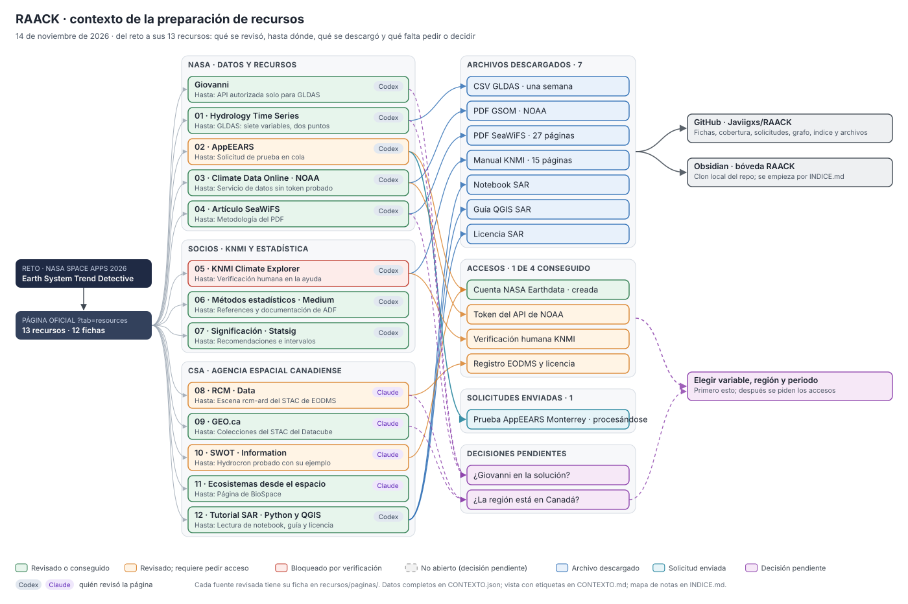

# Grafo de contexto de la preparación

[Índice](../INDICE.md) · [Cobertura de los 13 recursos](../recursos/COBERTURA.md) · [Bases de datos que hay que pedir](SOLICITUDES_DE_DATOS.md) · [Funcionalidades y tiempos](FUNCIONALIDADES.md) · [Datos del grafo en JSON](CONTEXTO.json)

El grafo resume el trabajo hecho para el reto. Parte de la página oficial y sus 13 recursos y muestra, para cada uno, hasta dónde se llegó, qué archivos se descargaron, qué acceso hay que pedir y qué decisiones siguen pendientes. Los colores indican el estado y la etiqueta, quién revisó cada página.



## Versión con etiquetas

GitHub y Obsidian dibujan este diagrama Mermaid. Las flechas continuas van a lo que se obtuvo o hay que pedir; las punteadas, a decisiones pendientes. El punto de parada de cada recurso está en la tabla siguiente.

```mermaid
flowchart LR
  reto["Reto · Be An Earth System Trend Detective!"] --> pagina["Página oficial de recursos · 13"]
  subgraph NASA["NASA · datos y recursos"]
    giovanni["Giovanni"]
    hydrology["01 · Hydrology Time Series"]
    appeears["02 · AppEEARS"]
    cdo["03 · Climate Data Online · NOAA"]
    seawifs["04 · Artículo SeaWiFS"]
  end
  subgraph Socios["Socios · KNMI y estadística"]
    knmi["05 · KNMI Climate Explorer"]
    medium["06 · Métodos estadísticos · Medium"]
    statsig["07 · Significación · Statsig"]
  end
  subgraph CSA["CSA · Agencia Espacial Canadiense"]
    rcm["08 · RCM · Data"]
    geo["09 · GEO.ca"]
    swot["10 · SWOT · Information"]
    ecosistemas["11 · Ecosistemas desde el espacio"]
    sar["12 · Tutorial SAR · Python y QGIS"]
  end
  pagina --> giovanni & hydrology & appeears & cdo & seawifs
  pagina --> knmi & medium & statsig
  pagina --> rcm & geo & swot & ecosistemas & sar
  subgraph ARCH["Archivos descargados · 7"]
    f_gldas["CSV GLDAS · una semana"]
    f_gsom["PDF GSOM · NOAA"]
    f_seawifs["PDF SeaWiFS · 27 páginas"]
    f_knmi["Manual KNMI · 15 páginas"]
    f_sar_nb["Notebook SAR"]
    f_sar_qgis["Guía QGIS SAR"]
    f_sar_lic["Licencia SAR"]
  end
  subgraph ACC["Accesos"]
    a_earthdata["Cuenta NASA Earthdata · creada"]
    a_noaa["Token del API de NOAA"]
    a_knmi["Verificación humana KNMI"]
    a_eodms["Registro EODMS y licencia"]
  end
  subgraph SOL["Solicitudes enviadas"]
    s_appeears["Prueba AppEEARS Monterrey · procesándose"]
  end
  subgraph DEC["Decisiones pendientes"]
    d_giovanni{"¿Giovanni en la solución?"}
    d_canada{"¿La región está en Canadá?"}
    d_caso{"Elegir variable, región y periodo"}
  end
  hydrology --> f_gldas
  cdo --> f_gsom
  seawifs --> f_seawifs
  knmi --> f_knmi
  sar --> f_sar_nb
  sar --> f_sar_qgis
  sar --> f_sar_lic
  appeears -->|cuenta y extracción| a_earthdata
  swot -->|descargar granulos| a_earthdata
  cdo -->|solo para el API| a_noaa
  a_noaa -.-> d_caso
  knmi -->|bloquea las herramientas| a_knmi
  a_knmi -.-> d_caso
  rcm -->|para descargar| a_eodms
  a_eodms -.-> d_caso
  appeears -->|prueba| s_appeears
  a_earthdata --> s_appeears
  s_appeears -.->|ayuda a decidir| d_caso
  giovanni -.->|solo descargas GLDAS autorizadas| d_giovanni
  hydrology -.->|su API enlaza Giovanni| d_giovanni
  seawifs -.->|lo usa como antecedente| d_giovanni
  rcm -.->|acceso público solo en Canadá| d_canada
  geo -.->|datos de Canadá| d_canada
  d_canada -.-> d_caso
  ARCH --> github["GitHub · Javiigxs/RAACK<br/>fichas, cobertura, solicitudes, grafo, índice y archivos"]
  github -->|clon local| obsidian["Obsidian · bóveda RAACK<br/>se empieza por INDICE.md"]
  classDef revisado fill:#e7f5ec,stroke:#2e7d4f,color:#1d2430
  classDef requiere fill:#fff4e5,stroke:#d9822b,color:#1d2430
  classDef bloqueado fill:#fdecea,stroke:#c0392b,color:#1d2430
  classDef noabierto fill:#f2f2f2,stroke:#8a8a8a,stroke-dasharray:5 4,color:#1d2430
  classDef archivo fill:#e8f1fb,stroke:#2f6fb5,color:#1d2430
  classDef acceso fill:#fff4e5,stroke:#d9822b,color:#1d2430
  classDef decision fill:#f6e8f7,stroke:#8e44ad,color:#1d2430
  classDef destino fill:#eef0f2,stroke:#3d4650,color:#1d2430
  classDef solicitud fill:#e6f4f8,stroke:#1b7f99,color:#1d2430
  classDef inicio fill:#1f2a44,stroke:#1f2a44,color:#ffffff
  class giovanni,hydrology,cdo,seawifs,medium,statsig,geo,ecosistemas,sar revisado
  class appeears,rcm,swot requiere
  class knmi bloqueado
  class  noabierto
  class f_gldas,f_gsom,f_seawifs,f_knmi,f_sar_nb,f_sar_qgis,f_sar_lic archivo
  class a_noaa,a_knmi,a_eodms acceso
  class a_earthdata revisado
  class s_appeears solicitud
  class d_giovanni,d_canada,d_caso decision
  class github,obsidian destino
  class reto,pagina inicio
```

## Punto de parada por recurso

| # | Recurso | Bloque oficial | Hasta dónde se llegó | Revisó |
|---|---|---|---|---|
| — | Giovanni | NASA · datos y recursos | API autorizada solo para GLDAS | Codex |
| 01 | [Hydrology Time Series](../recursos/paginas/01-hydrology.md) | NASA · datos y recursos | GLDAS: siete variables, dos puntos | Codex |
| 02 | [AppEEARS](../recursos/paginas/02-appeears.md) | NASA · datos y recursos | Solicitud de prueba en cola | Codex |
| 03 | [Climate Data Online · NOAA](../recursos/paginas/03-cdo.md) | NASA · datos y recursos | Servicio de datos sin token probado | Codex |
| 04 | [Artículo SeaWiFS](../recursos/paginas/04-seawifs.md) | NASA · datos y recursos | Metodología del PDF | Codex |
| 05 | [KNMI Climate Explorer](../recursos/paginas/05-knmi.md) | Socios · KNMI y estadística | Verificación humana en la ayuda | Codex |
| 06 | [Métodos estadísticos · Medium](../recursos/paginas/06-metodos-estadisticos.md) | Socios · KNMI y estadística | References y documentación de ADF | Codex |
| 07 | [Significación · Statsig](../recursos/paginas/07-significancia.md) | Socios · KNMI y estadística | Recomendaciones e intervalos | Codex |
| 08 | [RCM · Data](../recursos/paginas/08-rcm.md) | CSA · Agencia Espacial Canadiense | Escena rcm-ard del STAC de EODMS | Claude |
| 09 | [GEO.ca](../recursos/paginas/09-geo.md) | CSA · Agencia Espacial Canadiense | Colecciones del STAC del Datacube | Claude |
| 10 | [SWOT · Information](../recursos/paginas/10-swot.md) | CSA · Agencia Espacial Canadiense | Hydrocron probado con su ejemplo | Claude |
| 11 | [Ecosistemas desde el espacio](../recursos/paginas/11-ecosistemas.md) | CSA · Agencia Espacial Canadiense | Página de BioSpace | Claude |
| 12 | [Tutorial SAR · Python y QGIS](../recursos/paginas/12-sar.md) | CSA · Agencia Espacial Canadiense | Lectura de notebook, guía y licencia | Codex |

## Cronología del 14 de noviembre de 2026

1. **Codex (GPT):**
   - Revisó los recursos en Chrome, descargó 7 archivos y creó la bóveda de Obsidian.
   - Dejó Giovanni excluido y pendiente de decisión del equipo.
2. **Codex:** publicó en RAACK los 7 archivos, las notas y el catálogo (commit `d24ff79`).
3. **Codex:** empezó una ficha por página. Escribió las fichas 01 a 07 y la 12, pero se quedó sin uso antes de publicarlas.
4. **Claude (cuenta 2):** tomó el relevo de esas tareas.
   - Comprobó la lista oficial: 13 recursos.
   - Revisó en Chrome RCM, GEO.ca, SWOT y la página de ecosistemas.
   - Escribió las fichas 08 a 11, la cobertura, la nota de solicitudes de datos y este grafo, y lo publicó todo.
5. **La persona** creó la cuenta NASA Earthdata del equipo. Con ella, **Claude** envió una [solicitud de prueba de AppEEARS en Monterrey](SOLICITUD_APPEEARS_MONTERREY.md): NDVI y temperatura superficial de 2001 a 2025. A las 14:13 iba al 28 %.
6. **Claude** dejó el repo listo como bóveda de Obsidian tipo wiki:
   - Un [índice para personas e IAs](../INDICE.md).
   - Reglas para agentes en `AGENTS.md`.
   - Enlaces relativos que funcionan en GitHub y en Obsidian.
7. **Claude (cuenta 1)**, por la tarde:
   - Leyó la página oficial completa y las guías de evaluación y entrega: [Reglas oficiales](REGLAS_OFICIALES.md).
   - Probó los servicios abiertos: visor de hidrología con Monterrey (26 años al instante), catálogo de AppEEARS, datos de NOAA sin token y Hydrocron. Lo comprobado está en [Funcionalidades y tiempos](FUNCIONALIDADES.md) y en las fichas 01, 02, 03 y 10.
   - Escribió [Ideas para la herramienta](IDEAS.md), propuestas que el equipo debe decidir.
   - No descargó archivos de datos. No abrió Giovanni ni llamó a su API: usó solo el visor.

En la tabla, «Revisó» es quien hizo la primera revisión de la página. Las ampliaciones posteriores están fechadas al final de cada ficha.

## Actualización del 14 de noviembre de 2026 · continuación de las descargas

- GLDAS quedó descargado: 14 originales cada tres horas, siete variables en Monterrey y Galeana, de marzo de 2001 a julio de 2026. Las medias mensuales conservan conteos y marcan diez combinaciones incompletas del último mes.
- La persona autorizó el servicio de Giovanni únicamente para descargar las siete variables GLDAS; elegirlo como herramienta de la solución sigue pendiente. Ver [la decisión](decisiones/GIOVANNI.md).
- Se descargó el netCDF científico GRACE tras el inicio de sesión humano en Earthdata. Su MD5 coincide con el oficial; se conserva íntegro en seis partes reconstruibles y como recorte de Nuevo León.
- IMERG Final V07 termina en septiembre de 2025 según NASA y CMR. No se localizaron octubre–diciembre de 2025 como el mismo producto; no se sustituyeron ni interpolaron.
- Los archivos, límites, procedencia y uso de IA del lote regional se detallan en [Datos solicitados para Nuevo León](REQUISITOS_DATOS_NUEVO_LEON.md). Codex preparó esta actualización a partir de la conversación retomada y las verificaciones de esta sesión.

## Cómo actualizarlo

`CONTEXTO.json`, `CONTEXTO.svg` y esta nota se generan con [generar_contexto.py](generar_contexto.py) a partir de los mismos datos: tipo, estado, punto de parada, quién lo revisó y enlaces. Si cambia algo, por ejemplo al conseguir un acceso o enviar una solicitud, edita las listas del principio del script y ejecuta `python3 docs/generar_contexto.py docs` desde la raíz del repo.
