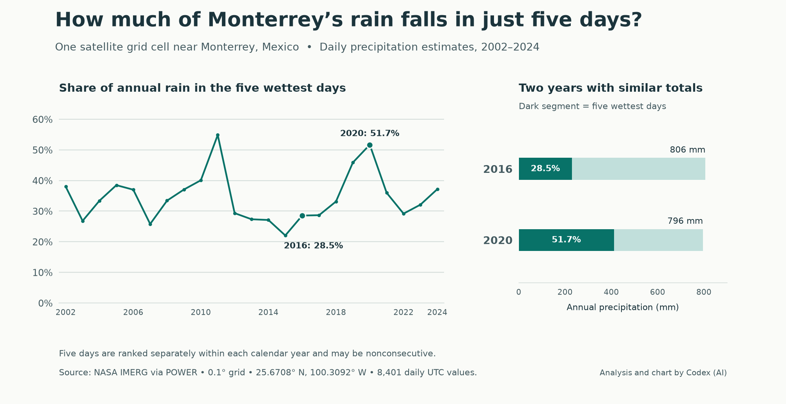

# ¿Cuándo le falta agua a Monterrey y cuándo llega de golpe?

Revisión del 14 de noviembre de 2026. Son casos que el equipo puede elegir para su detective. La selección de ejemplos, el código, la gráfica y esta nota se hicieron con Codex. Las observaciones de la estación son del SMN y las estimaciones de las celdas son de NASA.

## Tres problemas medibles

| Pregunta | Evidencia local | Qué podría hacer el detective |
|---|---|---|
| ¿El total del año oculta aguaceros concentrados? | En el punto de Monterrey, IMERG estimó 806,12 mm en 2016 y 795,55 mm en 2020. Sus cinco días más lluviosos reunieron el 28,5 % y el 51,7 %, respectivamente. | Mostrar dos calendarios, marcar los cinco días y permitir comprobar cuánto cambia su peso entre años con totales parecidos. Son años elegidos para ilustrar la diferencia. |
| ¿Cuándo coincide la falta de lluvia con suelo inusualmente seco? | De enero a julio de 2022, IMERG estimó 120,41 mm frente a una mediana de 311,52 mm para enero–julio de 2002–2021. La estación midió 127,27 mm en el mismo periodo. En julio, MERRA-2 estimó un índice de humedad en las raíces de 0,37, frente a 0,44 como mediana de los julios de referencia. | Comparar el acumulado con la misma época de otros años y ver si coincide con una segunda señal en el suelo. La [crisis de Cerro Prieto](https://ciencia.nasa.gov/ciencias-terrestres/un-embalse-en-mexico-se-seca/) da contexto histórico. El volumen de una presa depende también de su cuenca, la operación y las extracciones. |
| ¿Qué tan excepcional fue un mes de lluvias intensas? | IMERG estimó 366,81 mm en junio de 2024 frente a 62,25 mm como mediana de los junios de 2002–2023 (5,9 veces). El 20 de junio UTC aportó 154,22 mm. | Localizar el día extremo dentro del mes y contrastarlo con [los reportes de inundaciones y evacuaciones durante Alberto](https://www.gob.mx/guardianacional/prensa/en-nuevo-leon-y-tamaulipas-guardia-nacional-mantiene-apoyo-por-efectos-de-la-tormenta-tropical-alberto). La inundación se documenta con el reporte, la lluvia se estima con el satélite. |

Un ejemplo observado en tierra resume los tres problemas. La estación Monterrey Observatorio registró 47 días consecutivos con menos de 1 mm diario entre el 26 de febrero y el 13 de abril de 2022. El 4 de septiembre midió 197,5 mm, más que durante enero–julio juntos. Hubo registros válidos en los 365 días según la columna de precipitación publicada.

## Tendencia y validación

Para la fracción anual de los cinco días más lluviosos, la pendiente de Sen fue de +0,52 puntos porcentuales por década. El intervalo del 95 % va de −4,06 a +6,33 y la prueba de Kendall bilateral con los 23 años dio p = 0,794. La incertidumbre abarca ambos sentidos del cambio. La prueba exploratoria trata los años como independientes, sin ajuste por correlación entre años. Los cinco días pueden estar separados.

Los episodios tienen respaldo externo en fuentes de NASA y del gobierno mexicano. Las tres métricas se pueden reproducir y los productos NASA están vinculados a las familias de datos del reto. El diferenciador propuesto frente al visor que probó el equipo es mostrar juntos el total, su distribución por días y la respuesta del suelo, con una estación próxima para contrastar el episodio. Queda por probar con usuarios si esa comparación les sirve. En el selector, México abre el caso de Monterrey. Para informar resultados nacionales se necesita cobertura territorial y un método de agregación.

## Datos y reproducción

También se revisó un posible caso de calor urbano con el [CSV de temperatura superficial MODIS](../recursos/archivos/appeears-monterrey-2001-2025/RAACK-prueba-Monterrey-NDVI-LST-2001-2025-MOD11A2-061-results.csv). Para los compuestos de ocho días iniciados en junio–agosto de 2001–2025, se exigió temperatura nocturna válida y que los bits 0–1, 2–3 y 6–7 de QC_Night fueran cero (buena calidad y error estimado de hasta 1 K). En Macroplaza pasaron 0 de 299 fechas y en Pesquería y García coincidieron 158. Se tomó primero la mediana de las diferencias de superficie Pesquería menos García dentro de cada verano y luego la mediana de los 25 veranos: +0,57 °C. La diferencia es pequeña frente al margen de la medición. El caso ilustra por qué mostrar cobertura y calidad antes de comparar lugares.

- [Lluvia diaria](../recursos/archivos/monterrey-lluvia-nasa-power.csv). IMERG en NASA POWER, variable `IMERG_PRECTOT`, 8.401 días UTC completos del 1 de enero de 2002 al 31 de diciembre de 2024. Coordenadas consultadas 25,6708° N, 100,3092° O, malla de 0,1°. POWER permite extraer la serie del producto de lluvia disponible en el visor del reto. El CSV de POWER usa una etiqueta genérica MERRA-2 en la cabecera; [los metadatos JSON de la consulta](https://power.larc.nasa.gov/api/temporal/daily/point?parameters=IMERG_PRECTOT&community=AG&longitude=-100.3092&latitude=25.6708&start=20240619&end=20240621&format=JSON&time-standard=UTC) identifican IMERG y concuerdan con la [documentación de NASA](https://power.larc.nasa.gov/docs/methodology/data/sources_meteorology/).
- [Humedad mensual](../recursos/archivos/monterrey-humedad-nasa-power.csv). MERRA-2 en NASA POWER, 276 meses completos en las mismas coordenadas. La malla es más gruesa (0,5° × 0,625°). `GWETROOT` estima la saturación relativa de la zona de raíces de 0 a 1. La comparación usa una referencia del mismo mes. [Definición de NASA](https://gs6101-gmao.gsfc.nasa.gov/gmao-products/merra-2/faq_merra-2/).
- [Registro de Monterrey Observatorio](../recursos/archivos/smn-monterrey-19052.txt). Estación 19052 del SMN, San Nicolás de los Garza, 25,7336° N, 100,3047° O. Se incluye como contraste de superficie externo al listado del reto. Un pluviómetro y el promedio estimado en una celda pueden diferir por la localización y el horario de corte.
- [Manifiesto de los originales](../recursos/archivos/descargas.json), con las URL, fecha de descarga, tamaño y SHA-256. Se conservaron los bytes entregados por cada servicio.

Desde la raíz, `python3 docs/analizar_lluvia_monterrey.py` recalcula el análisis con SciPy. El [script](analizar_lluvia_monterrey.py) comprueba fechas, valores físicos, duplicados y cobertura antes de calcular. Para regenerar [la figura](lluvia_monterrey.png) con Matplotlib, ejecutar `python3 docs/graficar_lluvia_monterrey.py recursos/archivos/monterrey-lluvia-nasa-power.csv docs/lluvia_monterrey.png`. [Código de la figura](graficar_lluvia_monterrey.py).
